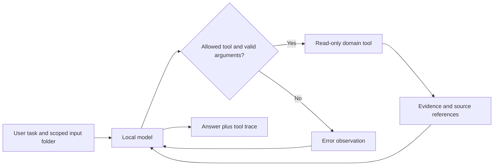

# Practical Agents

**Five agent prototypes that do useful work and leave evidence you can inspect.** The flagship is a context-first social editor: it can investigate a misleading cut, revise its caption and reject the same clip for an unsuitable account.

Built by Ananda Banerjee / Charlie Quant Lab with AI coding assistance. Python 3.9+, standard library only. No API key, package installation or model download is needed for the offline demos.

| Agent | Give it | Get back |
|---|---|---|
| [Context-First Social Editor](docs/social-editor.md) | A clip manifest, transcript, sampled frames and account policies | Context investigations, account-specific drafts and revision decisions; local video preparation/rendering utilities |
| [Open Paper Finder](docs/paper-finder.md) | A research question, or a metadata snapshot | Open-access paper links, versions, license metadata and retraction flags |
| [CSV Auditor](docs/csv-auditor.md) | A CSV and the columns that matter | Missing values, duplicate IDs, invalid numbers, robust outliers and date issues |
| [Document Change Reviewer](docs/document-reviewer.md) | Two text/Markdown versions | Exact changed wording with line references and source hashes |
| [Payment Reconciler](docs/payment-reconciler.md) | Invoice and payment exports | Settled balances, overdue invoices, duplicate payments and currency exceptions |

## Try all five in 30 seconds

```bash
git clone https://github.com/charlie-analytics/practical-agents.git
cd practical-agents
python3 -m agentkit all --demo
python3 -m unittest discover -s tests -v
```

These are **deterministic tool demos using fictional data**. They do not call an LLM and are not an agent performance benchmark. You can inspect [the saved demo results](docs/demo-results.json) without running anything.

The supplied examples produce:

- Social editor: a short cut appears to endorse guaranteed returns. Looking at the next sentence reverses that meaning. A wider cut passes mechanical review for a research account and is rejected for an unrelated travel account. The demonstration is scripted, not an LLM performance claim.
- CSV: 8 rows, one duplicated ID, a volume outlier at CSV row 6, a stale date, a future date and an invalid number.
- Documents: fee changes from USD 20 to USD 25; retention changes from 30 to 90 days; support and archiving terms also change.
- Payments: USD 200 and EUR 90 outstanding, with 5 payment exceptions. Currencies are never summed together.
- Papers: a fictional metadata snapshot demonstrates open/closed filtering, unknown licensing and retraction flags. Its example.org URLs are not real research papers.

## Run a model-driven agent locally

Install [Ollama](https://ollama.com/) and a model with tool-calling support that fits your computer. Start the Ollama service, then use its exact installed model name:

```bash
python3 -m agentkit csv-auditor \
  --workspace examples --model YOUR_INSTALLED_MODEL \
  --task "Audit observations.csv. Use id as the key, volume as numeric, date as the date column, 2026-09-29 as the reference date and 7 days as the freshness limit." \
  --output runs/csv-review.json
```

In this mode, the model chooses tools, receives their observations, can follow up, and writes the final explanation. Calls are bounded to 8 model turns and 16 tool invocations. Unknown tools and invalid arguments return errors. The complete tool trace accompanies the answer. A final answer requires a successful domain tool call; this is an evidence gate, **not a guarantee that the model's prose is correct**.

Local-model execution has no hosted inference charge, but requires your own compute and model download. No model is bundled. A live local-model run has not been benchmarked in this release; runner tests use scripted model responses. See [validation](docs/validation.md).

## Architecture



Each agent has its own tool allowlist and purpose. They share the runner because tool execution, limits and trace recording should work consistently across projects. Source files stay inside the selected workspace. There are no shell, arbitrary URL-fetch, payment-execution, email or file-edit tools exposed to the model. The separate media CLI invokes FFmpeg using fixed argument construction to prepare frames/audio and render an explicit edit plan.

## Inputs and privacy

- CSV input: UTF-8, unique headers, at most 20,000 rows / 2 MB. Decimal numbers use `.`; normalize locale-specific exports first.
- Document input: UTF-8 text or Markdown, at most 5,000 lines / 2 MB per version. Convert PDFs to text separately and check the extraction.
- Video preparation/rendering requires FFmpeg and ffprobe. Automatic local transcription optionally requires faster-whisper and its model download. Vision requires an installed local Ollama vision model. These are additional dependencies; the offline demos require none of them.
- Paper searches require `--network`, which sends search terms to OpenAlex. Other agents operate on local files only.
- Local file contents are sent to the local Ollama endpoint, not to a hosted model API. Run a local model; do not configure your Ollama installation to forward to cloud services if your inputs are private.
- Trace files contain source excerpts and records. `runs/`, `.env` and `private/` are ignored by Git. Review files before sharing.
- Files and tool outputs are treated as untrusted text. Tool restrictions limit possible actions; prompt instructions alone do not eliminate prompt-injection risk.

## What this portfolio demonstrates

Tool selection, bounded agent loops, evidence provenance, data validation, exact decimal arithmetic, error recovery, local inference integration and reproducible tests. These are working prototypes, not claims of production adoption, autonomous accuracy or measured time savings.

Source API docs: [Ollama chat](https://docs.ollama.com/api/chat), [OpenAlex API](https://help.openalex.org/api/), [OpenAlex access and pricing](https://help.openalex.org/access/pricing/).

MIT licensed. See [LICENSE](LICENSE).
